

  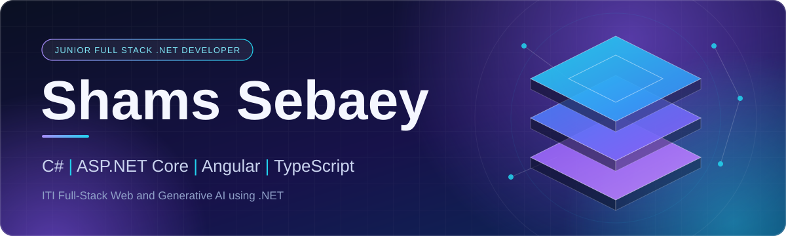

  <a href="#about-me">About</a> &nbsp;·&nbsp;
  <a href="#education--training">Education</a> &nbsp;·&nbsp;
  <a href="#technical-skills">Skills</a> &nbsp;·&nbsp;
  <a href="#featured-projects">Projects</a> &nbsp;·&nbsp;
  <a href="#github-analytics">Analytics</a> &nbsp;·&nbsp;
  <a href="#contact">Contact</a>

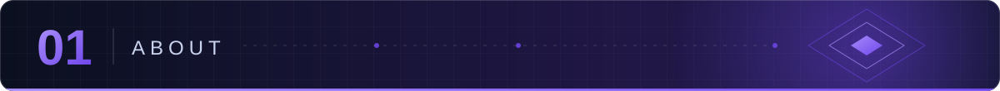

## About Me

I'm a Business Information Systems graduate and **Junior Full Stack .NET Developer**. I build web applications with C#, ASP.NET Core and Angular, with a focus on clean backend structure: relational data models, services, repositories and REST endpoints inside a Clean Architecture solution.

In my graduation project, a team of five, I built the **Study Rooms** feature end to end, including real-time chat with SignalR, and contributed to authentication and the AI diagnostic pipeline. I work in Git feature branches and resolve merge conflicts on shared codebases.

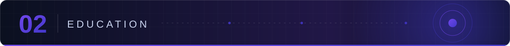

## Education & Training

**Information Technology Institute (ITI)** · January – June 2026 
Full-Stack Web & Generative AI Development using .NET. Intensive Training Program.

**Route IT Training Center** · Completed May 29, 2025 
Back-end (.NET Core) Diploma.

**Helwan University** · 2021 – 2025 
Bachelor of Business Information Systems, Faculty of Commerce and Business Administration. GPA 3.97.

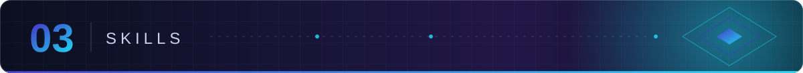

## Technical Skills

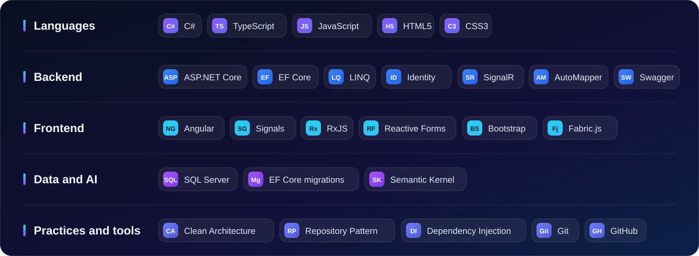

Skills as plain text

- **Languages:** C#, TypeScript, JavaScript, HTML5, CSS3
- **Backend:** ASP.NET Core Web API and MVC, Entity Framework Core, LINQ, ASP.NET Core Identity, SignalR, AutoMapper, Swagger
- **Frontend:** Angular, Angular Signals, RxJS, Reactive Forms, Bootstrap, Fabric.js
- **Data and AI:** Microsoft SQL Server, EF Core migrations, Semantic Kernel
- **Practices and tools:** Clean Architecture, Repository Pattern, Dependency Injection, Git, GitHub

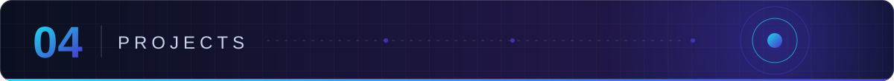

## Featured Projects

### PathForge

<a href="https://github.com/shamssebaey6-svg/PathForge">
  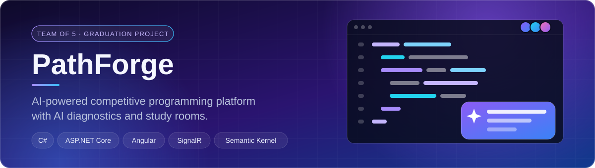
</a>

> An AI-powered competitive-programming learning platform: an in-browser code editor, AI hints and diagnostics after submissions, and study rooms. Built with ASP.NET Core (Clean Architecture), Angular and SQL Server.
>
> **What I built**
>
> - **Study Rooms**, end to end: EF Core data model, services, repositories, REST endpoints, and the Angular pages for room list, creation, details, members and resources.
> - **Real-time room chat** with SignalR, including member-only access and persisted message history.
> - **AI diagnostic pipeline (first version)** with Semantic Kernel: prompt construction, LLM response parsing and persistence. Teammates later extended it with confidence scoring and managed prompts.
> - **Authentication (co-developed with a teammate)**: email confirmation, Google sign-in and password reset, plus Angular login and signup flows with form validation, a route guard and a JWT HTTP interceptor.
> - **Personal whiteboard** built with Fabric.js, with drafts autosaved per user and problem through a REST API.
> - Worked with Git feature branches and resolved merge conflicts.
>
> **Stack:** C#, ASP.NET Core, Angular, TypeScript, EF Core, SQL Server, SignalR, Semantic Kernel

<a href="https://github.com/shamssebaey6-svg/PathForge">
  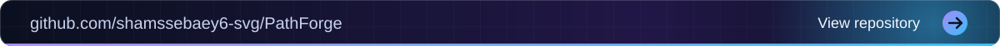
</a>

### TraineesTracking_MVC

<a href="https://github.com/shamssebaey6-svg/TraineesTracking_MVC">
  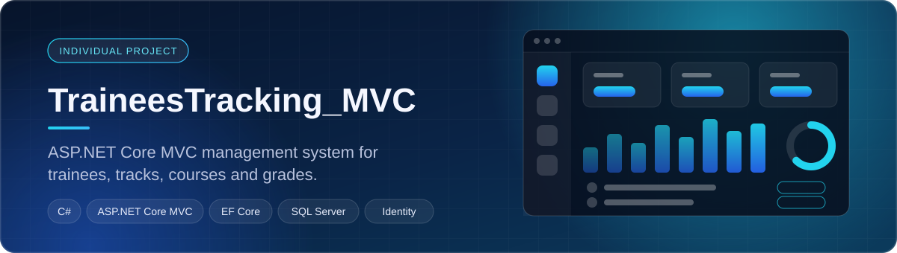
</a>

> An individual project: an ASP.NET Core MVC application for managing trainees, tracks, courses and grades. It models a many-to-many relationship between trainees and courses with a grade, uses ASP.NET Core Identity for registration and login, validates input with data annotations, and accesses data through a repository layer injected with Dependency Injection.
>
> **Stack:** C#, ASP.NET Core MVC, EF Core, SQL Server, Identity

### TaskManagement

<a href="https://github.com/shamssebaey6-svg/TaskManagement">
  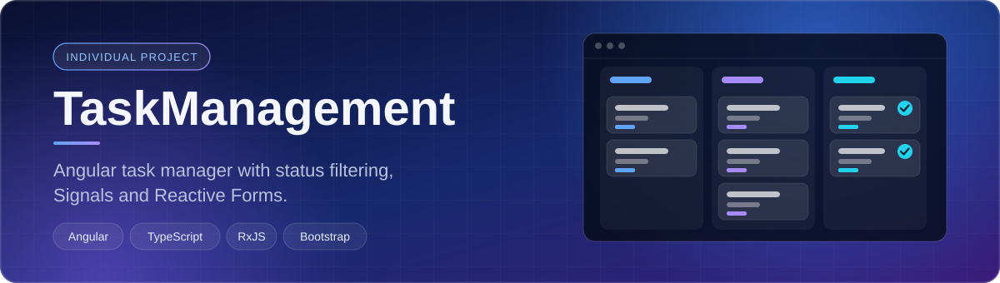
</a>

> An individual project: an Angular 21 and TypeScript task manager styled with Bootstrap. Users can create, update, complete, delete and filter tasks by status using Angular Signals. It includes a Reactive Forms signup with validation, a login page (a client-side demo, not real backend authentication) and a route guard. Data comes from a local mock REST API consumed through HttpClient and RxJS.
>
> **Stack:** Angular, TypeScript, RxJS, Bootstrap

<a href="https://github.com/shamssebaey6-svg/TaskManagement">
  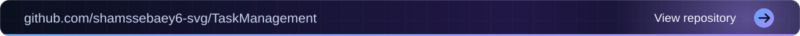
</a>

### ECommerce (VANTA)

<a href="https://github.com/shamssebaey6-svg/ECommerce">
  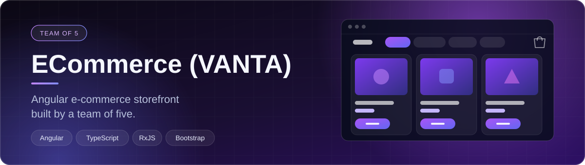
</a>

> A team project (5 contributors): an Angular e-commerce storefront.
>
> **What I built:** the repository setup, the home page, the shop page with category tabs, the product card component, and the product service that loads products through HttpClient and filters them by category with Angular Signals. Authentication, AI-powered search, checkout and pagination were built by my teammates.
>
> **Stack:** Angular, TypeScript, RxJS, Bootstrap

<a href="https://github.com/shamssebaey6-svg/ECommerce">
  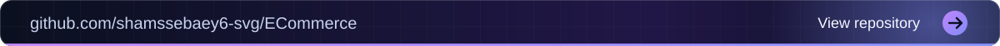
</a>

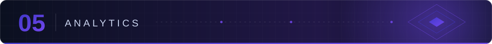

## GitHub Analytics

  

Live card from a third-party service. If it doesn't load, browse <a href="https://github.com/shamssebaey6-svg?tab=repositories">my repositories</a> or <a href="https://github.com/shamssebaey6-svg">my contribution activity</a> directly on GitHub.

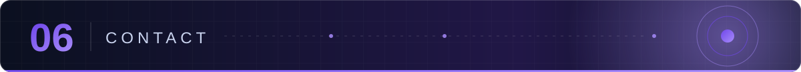

## Contact

[LinkedIn](https://www.linkedin.com/in/shams-sebaey-07538722a) · [GitHub](https://github.com/shamssebaey6-svg)

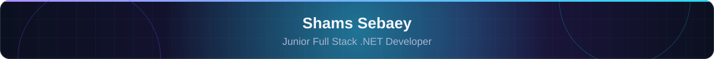
